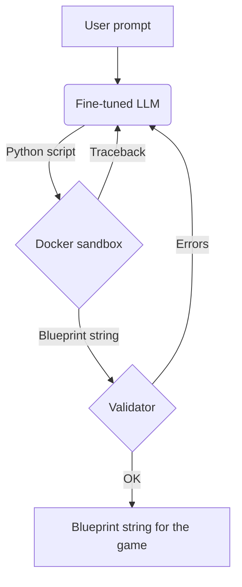

# FactorioLLM: Text-to-Blueprint Generator


**FactorioLLM** generates ready-to-use Factorio 2.0 blueprints from natural language prompts.

Type something like
> *"Create an expandable copper smelting line for 24 furnaces using red belts"*

and get a blueprint string you can paste into the game.

---

## How it works

Factorio blueprints are JSON documents with exact entity coordinates, compressed with `zlib` and encoded in
`base64`. Language models are poor at spatial reasoning: asked for raw JSON, they produce overlapping entities,
inserters facing the wrong way and belts that do not connect.

FactorioLLM therefore treats blueprint generation as a **text-to-code** task:

1. A locally fine-tuned model (LoRA on `Qwen2.5-Coder-7B-Instruct`, 4-bit) writes a short **Python script** that
   uses [factorio-draftsman](https://github.com/redruin1/factorio-draftsman) plus our own helpers and
   parametric layout modules (`smelting_column`, `mining_field`, `steam_power`, `balancer`, ...).
2. The script runs in a locked-down **Docker sandbox** (no network, read-only file system, resource limits)
   and prints the blueprint string. Copper wires between power poles are added automatically.
3. A static **validator** checks the result (overlaps, inserters working with buildings that hold no items,
   power coverage, belt ends, ...).
4. On an error the **agentic loop** sends the traceback or the validator report back to the model, up to three
   times.



The guiding principle: **the model decides what and how much to build; deterministic code decides where**.
Exact geometry, power wiring and balancers come from code and from templates mined from popular player
blueprints, not from the model's memory.

---

## Tech stack

* **Model:** `unsloth/Qwen2.5-Coder-7B-Instruct-bnb-4bit` + LoRA (Unsloth, TRL, PEFT); fits a 12 GB GPU.
* **Blueprint construction:** `factorio-draftsman` 3.3.1 (data for Factorio 2.0.77).
* **Data:** blueprints scraped from factorioprints.com into PostgreSQL; prompts written by Google Gemini
  (`google-genai`) from facts computed on each blueprint.
* **Sandbox:** Docker (`python:3.12-slim` + draftsman).
* **UI:** Gradio web studio and a CLI.
* **Package management:** `uv`.

---

## Getting started

*(The project is in active development; this is the local setup.)*

### Prerequisites

* Python 3.12 (exactly `3.12.*`) and `uv`
* Docker (for the sandbox)
* PostgreSQL (for the dataset pipeline)
* An NVIDIA GPU with CUDA for training and inference (developed on an RTX 5070, 12 GB)
* A `.env` file with `DATABASE_URL`, `GEMINI_API_KEY` (and optionally `PROXY_URL`, `GEMINI_MODEL`, `GEMINI_RPM`,
  `GEMINI_MAX_REQUESTS`, `TELEGRAM_BOT_TOKEN`)

### Installation

```bash
git clone https://github.com/CuteZerg/FactorioLLM.git
cd FactorioLLM
uv sync
docker build -f docker/Dockerfile.sandbox -t factoriollm-sandbox .
```

### Usage

```bash
uv run python src/factoriollm/app.py                         # Gradio web studio, http://127.0.0.1:7860
uv run python src/factoriollm/generate.py -p "4x4 balancer"  # CLI; the string is copied to the clipboard
```

The adapter is taken from `--adapter`, `$FACTORIOLLM_ADAPTER`, the newest folder in `adapters/`, or
`factorio_lora_model/`.

---

## Dataset pipeline

Blueprints are parsed into an integer **tile-grid IR** (`blueprint_ir.py`): every entity is stored by its
top-left tile, and 1.x (and 0.15+) strings are converted to 2.0 (renames, 8 → 16 directions, half-tile origin
shift). Only Factorio 2.0 **base-game** entities and recipes are kept (no Space Age, no mods). Grid snapping,
unwired label combinators / display panels and splitter settings are preserved.

```bash
uv run python src/factoriollm/init_db.py                                 # create / migrate tables
uv run python -m factoriollm.dataset_builder scrape --batch 500          # download new blueprints
uv run python -m factoriollm.dataset_builder canonical [--rebuild] [--dry-run]  # IR -> code -> sandbox check
uv run python -m factoriollm.dataset_builder prompts --rpm 60 --max-requests 1000  # Gemini EN/RU prompts
uv run python -m factoriollm.dataset_builder export                      # data/dataset_v4.jsonl + eval split
```

* `canonical` lifts each blueprint into compact code with macros and loops (`dataset_lifter.py`), runs it in the
  sandbox and keeps it only if the rebuilt blueprint is identical. Books with 100+ favorites contribute all
  children, books with 10+ up to 50, others up to 25.
* `prompts` sends several blueprints per request and rejects prompts with numbers that are not in the facts.

## Layout templates mined from player blueprints

`template_miner.py` finds the best tileable designs per category in the scraped corpus, cuts each into
**head + repeating segment + tail** (`templates.py`), checks that 1, 2 and 5 segments pass the validator and
draftsman's collision check, and writes:

* `data/templates/catalog.json` — the templates with provenance and density metrics;
* `outputs/templates/catalog.md` — a readable report;
* `outputs/templates/catalog_book.txt` — one blueprint book with all templates for checking in game.

```bash
uv run python -m factoriollm.template_miner --min-favorites 10
uv run python tools/extract_balancers.py          # balancer templates (Raynquist's book first) -> helpers.py
uv run python tools/extract_game_data.py         # base-game recipes, items, signals, recipe history
```

## Training and evaluation

```bash
uv run python src/factoriollm/train_model.py --run-name smoke --subsample per-blueprint --max-steps 20 --eval-steps 10
uv run python src/factoriollm/train_model.py --run-name pilot --subsample per-blueprint --epochs 1
uv run python -m factoriollm.eval_suite --adapter adapters/pilot [--retries 3]
uv run python -m factoriollm.eval_suite --compare outputs/eval/<a>.json outputs/eval/<b>.json
uv run python tools/overnight.py --detach         # unattended pipeline (Task Scheduler) + tools/train_monitor.py
```

The loss is computed on the assistant's code only. `eval_suite` measures completeness, execution, validity,
exact counts and belt tier on a fixed prompt set (A) and a held-out sample (B).

| Adapter | Valid blueprints | Exact counts | Notes |
| --- | --- | --- | --- |
| `factorio_lora_model` (old data) | 0% | 1% | Llama-3, broken coordinates |
| `pilot-qwen7b` (11k examples, 1 epoch) | 17% | 36% | |
| `full-qwen7b-2ep` (20.5k examples, 2 epochs) | 27% (33% with 3 retries) | 42% | current best |

Most remaining failures are collisions from hand-computed coordinates, which is why the next stage moves
geometry into templates and modules.

## Tests

```bash
uv run python -m unittest discover tests     # all (test_sandbox needs Docker; test_inference_eval needs a GPU)
```

---

## Roadmap

- [x] Scraping, tile-grid IR, sandbox, Gemini prompts, dataset v4
- [x] Validator, evaluation suite, configurable LoRA training, unattended runs
- [x] Parametric modules, automatic power wiring, balancer templates, grid snapping, label combinators
- [x] Template miner over popular player blueprints and an in-game review book
- [ ] Template fixes after the in-game review (product-based categories, modules and logistic requests,
      self-contained templates, computed grids, strict power checks, density-first defaults)
- [ ] Generic templates (assembler rows by number of input lanes, fluid rows, furnace lines) for any recipe
- [ ] Modules API on top of templates; synthetic and repair examples; dataset v5; fine-tuning
- [ ] Iterative refinement (edit a generated blueprint by instruction); mod support via game data dumps

---

## Contributing

Contributions are welcome! If you love Factorio and machine learning, feel free to open an issue or a pull
request.

## License

This project is licensed under the MIT License - see the [LICENSE](LICENSE) file for details.

*Disclaimer: This project is created for educational and community purposes. "Factorio" is a registered trademark of Wube Software Ltd.*
