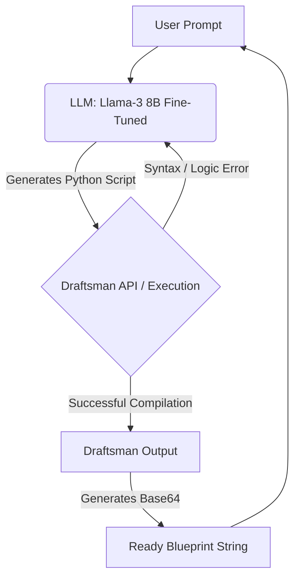

# FactorioLLM: Text-to-Blueprint Generator


**FactorioLLM** is an AI-powered tool that generates functional, ready-to-use blueprints for the game Factorio based on natural language prompts. 

Instead of manually placing entities or searching the web for specific layouts, you can just type: 
> *"Create an expandable copper smelting line for 24 furnaces using red belts,"* 

...and receive a working blueprint string instantly.

---

## How It Works (The Core Concept)

Factorio blueprints are essentially JSON objects containing raw coordinates, compressed via `zlib` and encoded in `base64`. 

**The Challenge:** Large Language Models (LLMs) lack spatial reasoning. Asking an LLM to output a raw JSON blueprint with exact x/y coordinates for hundreds of entities results in broken, non-functional layouts. Models do not inherently understand "tileability" or belt alignment.

**The Solution:** FactorioLLM uses a **Text-to-Code** approach. 
Instead of predicting JSON coordinates, the LLM generates a **Python script** utilizing the [factorio-draftsman](https://github.com/redruin1/factorio-draftsman) library. Concepts like spacing, alignment, and ratios are naturally handled through Python `for` loops, variables, and math. The backend then safely executes this script to compile a flawless blueprint string.

### The Agentic Loop Pipeline

The project features an automatic self-healing loop:



---

## Tech Stack

* **AI Models:** Fine-tuned Code-specific LLMs (`unsloth/llama-3-8b-Instruct-bnb-4bit`).
* **Training:** `Unsloth` for 2x faster 4-bit LoRA training, Hugging Face `transformers`, `PEFT` (LoRA).
* **Dataset Generation:** Google Gemini (`google-genai`), `factorio-draftsman`.
* **Package Management:** `uv`

---

## Getting Started

*(Note: The project is currently in active development. These instructions represent the local testing setup).*

### Prerequisites
* Python 3.12+
* `uv` package manager
* Factorio (for testing the generated blueprints)
* A GPU with CUDA support for training.

### Installation

1. Clone the repository:
   ```bash
   git clone https://github.com/yourusername/FactorioLLM.git
   cd FactorioLLM
   ```

2. Sync dependencies using `uv`:
   ```bash
   uv sync
   ```

### Usage

#### 1. Interactive Web Studio (Gradio)
Launch the local web application:
```bash
uv run python src/factoriollm/generate.py --web
# or
uv run python src/factoriollm/app.py
```
Open your browser at `http://127.0.0.1:7860`.

#### 2. Terminal CLI
Generate a blueprint directly from command line:
```bash
uv run python src/factoriollm/generate.py -p "Create a 4x4 belt balancer with fast transport belts"
```
The blueprint string will be automatically copied to your clipboard ready for in-game `Ctrl + V`.

### Dataset pipeline (v4)

Blueprints are parsed from their raw JSON into an integer **tile-grid IR** (`blueprint_ir.py`): every entity is
stored by its top-left tile, 1.x blueprints are converted to 2.0 (directions, renames), and only Factorio 2.0
vanilla entities are kept. Generated scripts use `tile_position=(x, y)` everywhere, so 1x1 and 2x2 entities share
one grid.

```bash
uv run python src/factoriollm/init_db.py                          # create / migrate tables
uv run python -m factoriollm.dataset_builder scrape --batch 500   # download new blueprints
uv run python -m factoriollm.dataset_builder canonical            # IR -> macro-lifted code -> sandbox verification
uv run python -m factoriollm.dataset_builder prompts --max-requests 50   # Gemini: grounded EN/RU prompts
uv run python -m factoriollm.dataset_builder export               # data/dataset_v4.jsonl + eval split
```

The `prompts` stage is free-tier friendly: several blueprints per request, `--rpm` throttling, a per-run
request budget, and a graceful stop on the daily quota; rerun it to continue. Configure `GEMINI_MODEL`,
`GEMINI_RPM`, `GEMINI_MAX_REQUESTS` in `.env`.

### Training and evaluation

```bash
# smoke test, then a pilot on one EN + one RU prompt per blueprint
uv run python src/factoriollm/train_model.py --run-name smoke --subsample per-blueprint --max-steps 20 --eval-steps 10
uv run python src/factoriollm/train_model.py --run-name pilot --subsample per-blueprint --epochs 1
# evaluate an adapter (GPU + Docker) and compare two reports
uv run python -m factoriollm.eval_suite --adapter adapters/pilot
uv run python -m factoriollm.eval_suite --compare outputs/eval/<a>.json outputs/eval/<b>.json
```

The default base model is `unsloth/Qwen2.5-Coder-7B-Instruct-bnb-4bit` (`--base-model` to change); the loss is
computed on the assistant's code only. Generated blueprints are checked by `validator.py`: overlapping entities and
inserters working with buildings that hold no items are errors, other findings are categorised warnings.

---

## Project Roadmap

- [x] **Phase 0: Proof of Concept** - Manual validation of Draftsman code generation.
- [x] **Phase 1: Data Engineering** - Fetching blueprints from factorioprints and decompiling them.
- [x] **Phase 2: Synthetic Prompts** - Using Google Gemini to attach diverse human prompts to the decompiled scripts.
- [x] **Phase 3: Fine-Tuning** - Training a LoRA adapter for Llama-3 to understand Factorio logic and Draftsman syntax (`factorio_lora_model`).
- [x] **Phase 4: Inference & Agentic Loop** - Closed Docker sandbox execution with automatic error recovery (3 retries).
- [x] **Phase 5: User Interface** - Interactive Gradio Web Studio and CLI runner with clipboard integration.

---

## Contributing

Contributions are welcome! If you love Factorio and Machine Learning, feel free to open an issue or submit a Pull Request.

## License

This project is licensed under the MIT License - see the [LICENSE](LICENSE) file for details.

*Disclaimer: This project is created for educational and community purposes. "Factorio" is a registered trademark of Wube Software Ltd.*